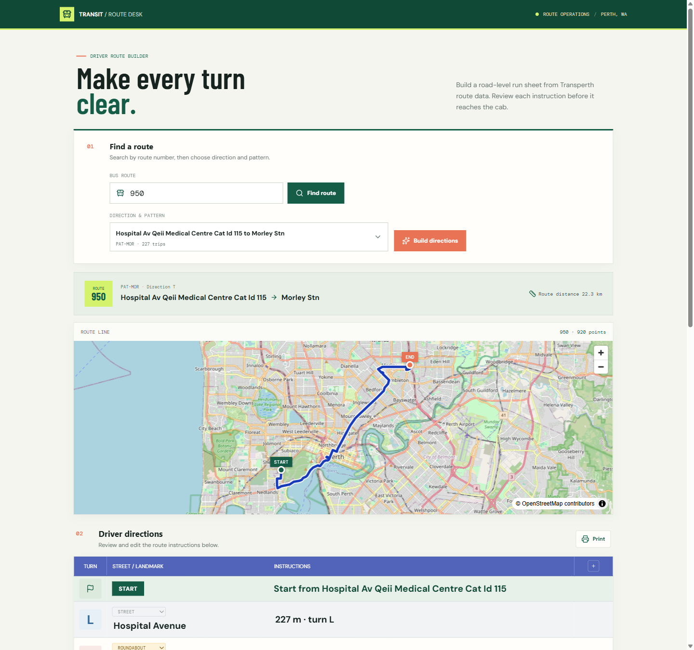

# Transperth Route Desk

Transperth Route Desk is a route-planning aid for bus drivers in Perth, Western Australia. It turns Transperth route data into a map and a road-level run sheet, making it easier to prepare for a route and review its turns before a journey.

**[Open the live app](https://transperth-route.vercel.app/)**

## What it does

- Find a bus route by number and choose its direction and pattern.
- See the route on an interactive map, with its start, end and distance.
- Generate a run sheet with turns, street names and maneuver details.
- Review and edit the instructions, add or remove rows, and print the result.

**Preview only:** Generated directions require human review before use. Always check them against current route information and road conditions.

## How it works

The app combines Transperth route data with OpenStreetMap road data and OSRM routing. The frontend is built with React, TypeScript and MapLibre GL; the backend uses FastAPI and PostGIS.

Map data &copy; [OpenStreetMap contributors](https://www.openstreetmap.org/copyright).

## Testing

See the [backend test guide](backend/tests/README.md), [end-to-end test guide](e2e/README.md), and [performance test guide](perf/README.md).
